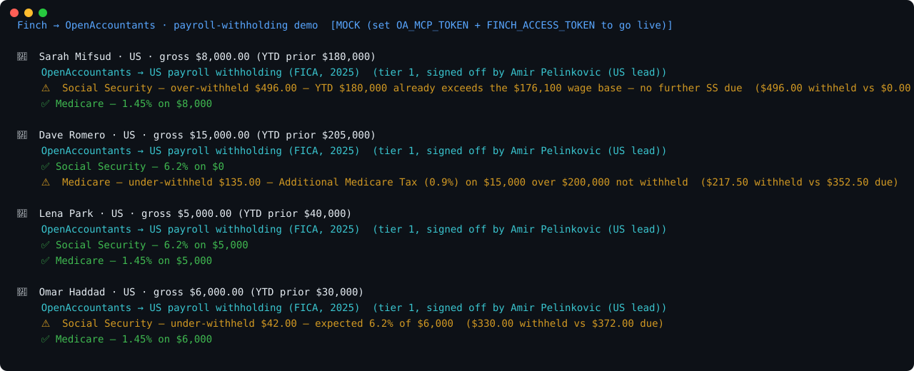

# Finch → OpenAccountants: payroll-withholding demo

**The pitch in one line:** Finch gives you payroll data from 200+ systems through one API. OpenAccountants tells you whether the **withholding on it is correct** — recomputed against verified rates and signed off by a named licensed accountant.

```
Finch pay statement (any of 200+ payroll systems)
  └─ { gross, ytd, social_security, medicare, ... }
        └─ OpenAccountants MCP  →  load the verified withholding skill
              └─ Verdict:  ✅ Social Security / Medicare correct
                           ⚠️ SS over-withheld past the wage base   ← catch
                           ⚠️ Additional Medicare (0.9%) over $200k missed   ← catch
                 · recomputed from gross + YTD, cited
                 · the named CPA who signed off the rates
```



> Regenerate the visual: `python make_svg.py` (static SVG, no deps) · animated GIF: `brew install vhs && vhs demo.tape`

## Why this is high-leverage

Finch is an **aggregator** — one integration already speaks Gusto, ADP, Rippling, Paychex, and 200+ more. So a single OpenAccountants check here validates payroll withholding **across every system Finch connects**, in one pass. No per-provider work.

- **Finch = the unified payroll data.**
- **OpenAccountants = the correctness layer.** Recompute the FICA (and, jurisdiction by jurisdiction, the rest) from gross + YTD against verified rates → flag the silent, expensive errors, with a named accountant behind the numbers.

## What it shows

Four pay statements run through the OpenAccountants MCP:

| Employee | Catch |
|---|---|
| YTD over the wage base | ⚠️ **Social Security still being withheld** (none is due) |
| Earnings over $200k | ⚠️ **Additional Medicare Tax (0.9%) not withheld** |
| Mid-range earner | ✅ SS + Medicare correct |
| SS at 5.5% | ⚠️ **Under-withheld** vs the verified 6.2% |

**The money shots:** payroll systems mis-handle the *edges* — the Social Security **wage-base cap** ($176,100 for 2025) and the **Additional Medicare Tax** over $200k are the two most-missed. OpenAccountants recomputes from gross + YTD and catches both before they hit a W-2.

## Run it

```bash
git clone https://github.com/openaccountants/finch-payroll-demo
cd finch-payroll-demo
python pipeline.py                       # bundled sample statements (mock mode, no keys)
python pipeline.py samples/pay_statements.json
```

### Go live

```bash
export OA_MCP_TOKEN=...          # OpenAccountants account token (the MCP requires auth)
export FINCH_ACCESS_TOKEN=...    # Finch token (free self-serve sandbox available)
python pipeline.py
```

- With `OA_MCP_TOKEN`, `oa_client.py` calls the live MCP (`start` → `get_skill`).
- With `FINCH_ACCESS_TOKEN`, `finch_client.py` pulls real pay statements instead of the bundled samples.
- With neither, it runs on the samples so the flow is visible today.

## Files

| File | Role |
|------|------|
| `pipeline.py` | Orchestrator + CLI: Finch → OA → verdict report |
| `finch_client.py` | Finch pay-statement extraction (live API or bundled sample) |
| `oa_client.py` | OpenAccountants MCP JSON-RPC client (live or mock) |
| `withholding_check.py` | Recomputes FICA from gross + YTD → verdict |
| `samples/pay_statements.json` | Finch-shaped pay statements |

## Honest notes

- `withholding_check.py` covers **employee-side FICA only** (Social Security + Medicare incl. the 0.9% surtax) — not federal/state income-tax tables, SUTA, or garnishments. Production leans on the full OA skill + an agent step; the named-CPA sign-off makes the verdict relianceable.
- Rates (6.2% / $176,100 / 1.45% / 0.9% over $200k) are 2025 figures; live, every value comes from `get_skill`. The verifier (Amir Pelinkovic) is the real OpenAccountants US lead.
